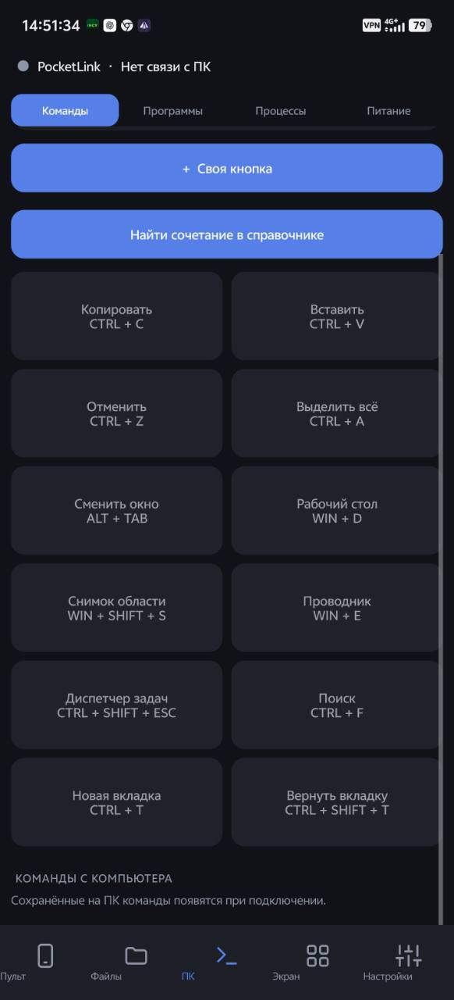

# PocketLink

Android-пульт для Windows: тачпад, клавиатура и свои сочетания, экран ПК на телефоне, файлы, буфер обмена, звук и YouTube.

**В репозитории теперь есть полный Android-проект версии 1.4.0**, включая исходники интерфейса, ресурсы, справочник сочетаний и Gradle Wrapper. Это рабочая исходная версия для улучшения визуала, а не только APK.

- **Для Claude и других разработчиков: [задание и карта интерфейса](docs/UI-HANDOFF.md).**
- [Исходники Android](android/)
- [Последние сборки и изменения](https://github.com/olegskorostrel-wq/PocketLink/releases)
- [Android APK 1.4.0](https://github.com/olegskorostrel-wq/PocketLink/releases/download/v1.4.0-preview/PocketLink.apk)
- [Windows ZIP 1.2.0, совместим с Android 1.4.0](https://github.com/olegskorostrel-wq/PocketLink/releases/download/v1.3.0-preview/PocketLink-Windows.zip)

## Расширение для Chrome и Яндекс Браузера

Расширение ставится **на компьютере**, в тот браузер, где ты смотришь YouTube. На телефон его устанавливать не нужно: телефон управляет им через приложение PocketLink и Windows-программу.

**[Скачать PocketLink-Chrome-Yandex.zip](https://github.com/olegskorostrel-wq/PocketLink/releases/download/v1.4.0-preview/PocketLink-Chrome-Yandex.zip)**

Один архив подходит обоим браузерам. Сейчас по этой ссылке опубликовано расширение **1.2.1**, совместимое с Windows 1.2.0 и Android 1.4.0. Номер релиза GitHub и номер расширения могут различаться. Доработанный пакет 1.3.0 ещё готовится к выпуску; ниже описаны кнопки опубликованной версии 1.2.1.

### 1. Скачай и распакуй в постоянную папку

1. Открой ссылку **«Скачать PocketLink-Chrome-Yandex.zip»** выше. Если откроется страница релиза, найди блок **Assets** и нажми именно **PocketLink-Chrome-Yandex.zip**.
2. Нужен этот ZIP. **PocketLink.apk** предназначен для телефона, **PocketLink-Windows.zip** — для программы ПК, **Source code** — для исходников проекта.
3. Дождись окончания загрузки. В Chrome и Яндекс список загрузок обычно открывается сочетанием **Ctrl + J**.
4. Открой папку, куда скачан архив. Нажми по ZIP правой кнопкой → **«Извлечь всё…»**.
5. Выбери постоянную папку, например **Документы → PocketLink → BrowserExtension**. Удобнее сразу распаковать туда, чем потом перемещать установленное расширение.
6. Открой распакованную папку. В ней должны лежать рядом файлы `manifest.json`, `background.js`, `youtube.js`, `options.html`, `options.js` и инструкция `INSTALL.md`.
7. Если внутри оказалась ещё одна папка, зайди в неё. При установке нужна именно та папка, **в которой непосредственно находится `manifest.json`**.

Пример расположения:

```text
Документы
└─ PocketLink
   └─ BrowserExtension
      ├─ manifest.json
      ├─ background.js
      ├─ youtube.js
      ├─ options.html
      ├─ options.js
      └─ INSTALL.md
```

После установки распакованную папку нельзя удалять или переносить: браузер использует файлы прямо из неё. Скачанный ZIP после распаковки можно удалить. Архив не нужно запускать и переименовывать в `.exe` или `.crx`.

### 2А. Установка в Google Chrome

1. Открой **Google Chrome на ПК**, в обычном окне и в том профиле, которым пользуешься для YouTube.
2. Нажми **Ctrl + L**, вставь `chrome://extensions` и нажми **Enter**. Это адрес внутренней страницы браузера: его нужно вставить в адресную строку, а не искать через Google.
3. На странице расширений включи переключатель **«Режим разработчика»**. Обычно он находится справа вверху.
4. Появятся дополнительные кнопки. Нажми **«Загрузить распакованное расширение»** / **Load unpacked**.
5. В окне выбора выдели распакованную папку **BrowserExtension**, внутри которой лежит `manifest.json`, и нажми **«Выбор папки»**. Выбирается папка, а не ZIP и не отдельный файл.
6. В списке должна появиться карточка **PocketLink YouTube**. Переключатель на ней должен быть включён.
7. Справа от адресной строки нажми значок расширений — обычно он выглядит как **пазл**. Найди **PocketLink YouTube** и закрепи его значком булавки, если такая кнопка есть.
8. Если YouTube уже был открыт, обнови его вкладку клавишей **F5**. Без этого новая версия расширения может ещё не работать на старой вкладке.
9. Перейди к разделу **«Подключи расширение к PocketLink»** ниже. Одной установки недостаточно: расширению ещё нужны порт и ключ из программы на ПК.

### 2Б. Установка в Яндекс Браузер

1. Открой **Яндекс Браузер на ПК**, в обычном окне и в своём профиле YouTube.
2. Нажми **Ctrl + L**, вставь `browser://extensions` и нажми **Enter**. Вводи именно этот внутренний адрес в адресную строку.
3. Включи **«Режим разработчика»**, если переключатель выключен.
4. Нажми **«Загрузить распакованное расширение»**.
5. Выбери постоянную распакованную папку с `manifest.json` и подтверди **«Выбор папки»**. Сам ZIP выбирать не нужно.
6. Убедись, что появилась карточка **PocketLink YouTube** и расширение включено.
7. Найди PocketLink YouTube в меню расширений возле адресной строки. При необходимости закрепи значок на панели; названия кнопок закрепления могут отличаться между версиями Яндекс Браузера.
8. Открой YouTube либо обнови уже открытую вкладку через **F5**.
9. Выполни настройку подключения ниже.

Если нужных кнопок нет, проверь адрес страницы и обнови браузер через его обычное меню «О браузере». Для этого пакета нужна поддержка Manifest V3 и API Chromium 120 или новее. На рабочем/учебном компьютере установку может запрещать администратор. Если Яндекс блокирует расширение политикой безопасности, не отключай защиту браузера: сохрани текст сообщения для диагностики. Этот пакет пока устанавливается вручную, версии из магазина ещё нет.

### 3. Подключи расширение к PocketLink

1. Запусти **PocketLink на Windows**. Программа должна продолжать работать во время управления с телефона; если её окно закрыто, проверь, остался ли значок PocketLink в области возле часов Windows.
2. Открой окно PocketLink на ПК и перейди в **«Настройки»**.
3. Найди карточку **«YouTube в Firefox»**. В Windows 1.2.0 она ещё так называется, но её ключ подходит **также для Chrome и Яндекс Браузера**.
4. Скопируй **полный ключ** из этой карточки. Это длинная строка из 64 символов. Нужен именно ключ YouTube, **не PIN и не QR-код сопряжения телефона**. Не публикуй ключ в переписке или на GitHub.
5. Нажми значок **PocketLink YouTube** в установленном браузере.
6. В поле **«Порт»** укажи порт локального окна программы PocketLink. Обычно это **48210**. Если адрес окна, например, `http://localhost:48211/…`, нужен **48211**. Порт — число после двоеточия; IP-адрес ПК и порт сопряжения телефона сюда не подходят.
7. Если PocketLink открыт отдельным окном без видимой адресной строки, сначала оставь стандартное значение **48210**. Если он занят, сервер может выбрать другой порт в диапазоне **48210–48219** — тогда потребуется фактический порт текущего окна.
8. Вставь скопированный ключ в поле **«Ключ»** и нажми **«Сохранить»**. В расширении 1.2.1 сообщение «Сохранено» подтверждает сохранение настроек, **а не успешную связь с сервером**. Работу нужно проверить следующим шагом.
9. Открой `https://www.youtube.com/` в этом же браузере и обнови вкладку после установки. Для первой проверки оставь одну вкладку YouTube, чтобы было ясно, каким плеером управляет телефон.
10. На телефоне открой PocketLink и подключись к компьютеру. Первое подключение телефона и ПК выполняется отдельно по QR из окна ПК; для локального подключения они должны находиться в одной доступной друг другу сети.
11. На телефоне перейди в **«Настройки» → «Пульт и экран» → «YouTube — поиск и пульт»**.
12. Найди видео, проверь появление названия и обложки, открой его. Затем проверь паузу, перемотку и громкость. Это практическая проверка всей цепочки: телефон → PocketLink на ПК → расширение → YouTube.

Первый запуск видео может потребовать нажатия Play на ПК из-за правил автовоспроизведения. Полноэкранный режим тоже может требовать действия непосредственно в браузере. Остальные функции не должны считаться проверенными только потому, что расширение удалось установить.

### 4. Останется ли расширение после закрытия браузера?

В обычном Chrome загрузка распакованного расширения сохраняется в выбранном профиле — добавлять его заново при каждом запуске не требуется. В Яндекс Браузере установка также обычно сохраняется, но политики браузера или организации могут отключать расширения из внешних источников.

Чтобы установка сохранялась:

- Не удаляй и не перемещай распакованную папку.
- Не удаляй расширение с его карточки и не отключай его переключатель.
- Сохраняй режим разработчика для этого способа установки.
- Открывай тот же профиль браузера. В другом профиле расширение устанавливается отдельно.
- Не рассчитывай на работу в режиме инкогнито: эта инструкция относится к обычному окну.

**Важно:** в текущей Windows-программе ключ YouTube меняется после полного перезапуска PocketLink. Само расширение при этом остаётся установленным. Если после перезапуска ПК управление перестало работать, открой карточку «YouTube в Firefox» и заново сохрани новый ключ в расширении. После обычного закрытия и открытия браузера, когда PocketLink на Windows продолжал работать, ключ обычно менять не нужно.

### 5. Как обновлять расширение

Обновления Android-приложения и расширения — разные вещи. Установка нового APK на телефон не обновляет расширение Chrome/Яндекс автоматически. В текущем способе установки обновление расширения выполняется вручную:

1. Скачай новый **PocketLink-Chrome-Yandex.zip** из релиза PocketLink.
2. Закрой вкладки YouTube и окно настроек расширения.
3. Распакуй новые файлы **в ту же постоянную папку**, откуда установлено расширение. Подтверди замену файлов. Не создавай случайно лишнюю вложенную папку: рядом с прежним `manifest.json` должны оказаться новые файлы.
4. Открой `chrome://extensions` в Chrome или `browser://extensions` в Яндекс.
5. На карточке **PocketLink YouTube** нажми кнопку **«Обновить» / «Перезагрузить»** со значком круговой стрелки, если она доступна в этой версии браузера.
6. Снова открой YouTube и обнови страницу. Если вкладок несколько, обнови каждую.
7. Проверь порт и ключ. При перезагрузке расширения в той же папке локальные настройки обычно сохраняются; после удаления и новой установки их может потребоваться ввести заново.

Не используй кнопку «Удалить» как обычный способ обновления: она может удалить сохранённые настройки. Автоматического обновления из магазина пока нет.

### 6. Если что-то не работает

| Что происходит | Что проверить |
|---|---|
| ZIP скачался, но расширение не появилось | Сначала распакуй ZIP, затем используй «Загрузить распакованное расширение». Открытие архива само ничего не устанавливает. |
| «Файл манифеста отсутствует» / Manifest missing | Выбрана не та папка. Зайди туда, где непосредственно лежит `manifest.json`. |
| Появилась ошибка Manifest V2 | Для Chrome/Яндекс скачан не тот пакет. Нужен **PocketLink-Chrome-Yandex.zip**, а не Firefox ZIP. |
| Не вижу значок PocketLink на панели | Проверь включённую карточку на странице расширений и меню с пазлом/списком расширений возле адресной строки. |
| Сохранено, но телефон не управляет видео | «Сохранено» в версии 1.2.1 не проверяет соединение. Запусти Windows-программу, проверь порт и полный ключ YouTube, обнови вкладку YouTube. |
| После перезагрузки ПК всё перестало работать | Расширение могло остаться, а ключ Windows-программы изменился. Внеси новый ключ в настройках расширения. |
| После установки ничего не изменилось в открытом YouTube | Обнови страницу через F5, чтобы на ней загрузилось расширение. |
| Управляется другое видео | Для проверки оставь одну вкладку YouTube и один браузер с подключённым PocketLink. |
| YouTube вообще не открывается на ПК | Сначала добейся обычного открытия сайта в этом браузере. Расширение не обеспечивает обход блокировок. |
| На телефоне «Нет связи с ПК» | Сначала настрой соединение телефона и Windows-программы; расширение не заменяет сопряжение. |
| Браузер сообщает о блокировке политикой | На управляемом ПК обратись к администратору; при блокировке защитой сохрани сообщение. Не отключай защиту ради установки. |
| Не включается полноэкранный режим | Попробуй включить его на ПК: браузер может требовать непосредственного действия пользователя. |
| После переноса папки расширение перестало загружаться | Верни папку на прежнее место. Если это невозможно, загрузи её заново с нового места и заново укажи настройки при необходимости. |

Если проблема осталась, полезны: название и версия браузера, версия Windows-программы и расширения, точный текст ошибки и этап, на котором она появилась. Сам ключ подключения присылать не нужно.

**Статус проверки:** JavaScript расширения и обмен сообщениями проверены автоматически; установка и вся цепочка управления на настоящем Chrome/Яндекс пока не проверены. Подробные ограничения указаны, чтобы инструкция не обещала больше, чем реально проверено.

Справка производителей: [загрузка распакованного расширения в Chrome](https://developer.chrome.com/docs/extensions/get-started/tutorial/hello-world), [управление расширениями в Яндекс Браузере](https://yandex.ru/support/browser/ru/personalization/extension).


## Вид приложения

На скриншоте экран команд из 1.3.0. В исходниках 1.4.0 уже изменены карточки, плитки, навигация и верхняя панель; снимок сохранён как исторический пример, а не как актуальный вид 1.4.0.



Более ранние скриншоты настроек и точные различия версий — в [задании по визуалу](docs/UI-HANDOFF.md).

## Сборка Android

Нужны JDK 17 и Android SDK 35. Открыть папку `android` в Android Studio либо настроить `ANDROID_HOME` и выполнить:

```powershell
cd android
.\gradlew.bat assembleDebug lintDebug
```

Linux/macOS:

```sh
cd android
sh ./gradlew assembleDebug lintDebug
```

APK: `android/app/build/outputs/apk/debug/app-debug.apk`. Для автономной сборки сервер Windows не нужен. Пакет `com.pocketlink.app`, имя PocketLink, minSdk 29, targetSdk 35.

Ключ подписи опубликованных APK не хранится в Git. Собранный на другой машине debug APK обычно имеет другую подпись и не установится поверх текущего. Для выдачи пользователю обновления верни изменения исходников владельцу проекта, чтобы он собрал APK прежним ключом. Удалять установленное приложение для обхода ошибки подписи не следует: можно потерять сопряжение и настройки.

В этом репозитории сейчас опубликована Android-часть. Исходники Windows-сервера и расширений браузера сюда пока не добавлены; готовая совместимая Windows-сборка доступна по ссылке выше.
