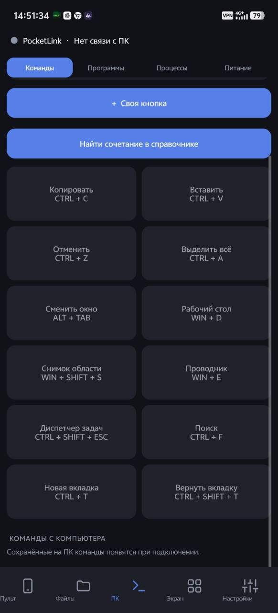
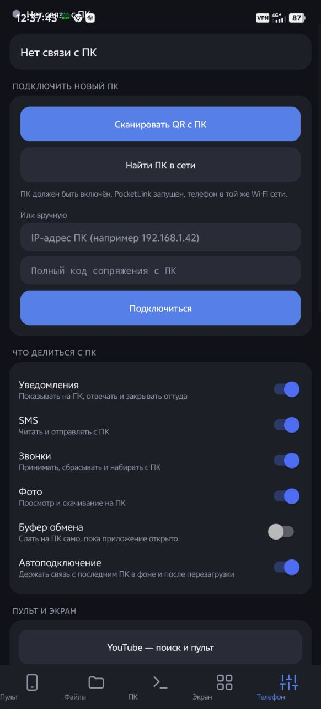
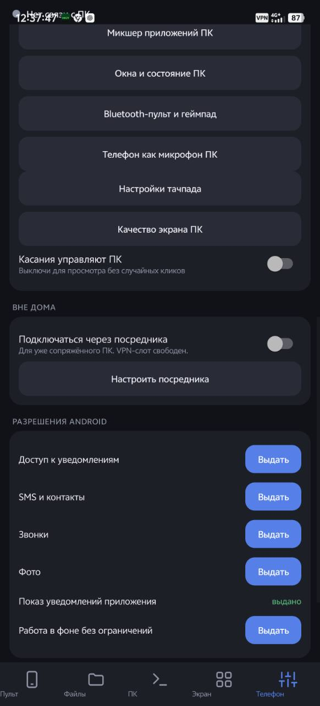

# Визуал PocketLink: передача работы Claude

## Задача пользователя

Сделать интерфейс Android-приложения аккуратнее и удобнее, сохранив действующие функции. Основной телефон — iQOO 13, версия Android со слов пользователя около 17; ПК — Windows 11. Основной браузер Firefox, также нужны Chrome и Яндекс. Название приложения всегда PocketLink, номера только в версиях и релизах.

Пользователю не нравятся перегруженные крупными кнопками настройки, пустые экраны без подключения, неточные отступы и съехавшие подписи нижней навигации. Сделай цельный визуальный стиль, понятные акценты, компактную навигацию и удобные элементы для управления ПК одной рукой. Редизайн нужно реализовать в коде, а не ограничивать описанием.

## Что реально есть в коде

- Полный Android-проект 1.4.0, Kotlin + нативные Android Views. Это **не Compose**. Большинство экранов строится программно, а не layout XML.
- Цветовая тема автоматически следует системной светлой/тёмной теме.
- Пять основных вкладок: Пульт / Файлы / ПК / Экран / Настройки.
- Быстрые сочетания: 12 начальных кнопок, свои сочетания с Ctrl/Alt/Shift/Win, сохранение на телефоне, редактирование/удаление удержанием. Экран доступен без ПК.
- Справочник 104 сочетаний с русскими синонимами, категориями, поиском и добавлением на панель. В том числе устройство воспроизведения — Win+Ctrl+V, история буфера — Win+V.
- Встроенная проверка обновлений GitHub, загрузка и проверка подписи APK, установка через системный интерфейс Android.

## Карта файлов

Все пути относительно корня репозитория. Kotlin-файлы находятся в `android/app/src/main/java/com/pocketlink/app/`.

| Файл | Что меняет |
|---|---|
| `MainActivity.kt` | Каркас, статус подключения, нижняя навигация, системные отступы, открытие вспомогательных экранов |
| `Ui.kt` | Цвета `T`, карточки, кнопки, поля, переключатели, общие строки инструментов |
| `RemotePage.kt` | Тачпад, клавиши мыши, клавиатура, медиа, презентации |
| `ToolsPage.kt` | Вкладка ПК: команды, программы, процессы, питание |
| `ShortcutPanel.kt` | Плитки сочетаний и редактор своей кнопки |
| `ShortcutCatalogPage.kt` | Поиск, фильтры, результаты и детали сочетания |
| `DevicePage.kt` | Подключение, QR, раскрывающиеся настройки, доступы Android |
| `ScreenPage.kt` | Просмотр экрана ПК и управление им |
| `FilesPage.kt` | Файлы и передачи |
| `YouTubePage.kt` | Поиск видео, обложки и пульт YouTube |
| `MixerPage.kt`, `DesktopPage.kt` | Звук, окна и состояние ПК |
| `BluetoothPage.kt`, `MicrophonePage.kt` | Дополнительные инструменты |
| `UpdatesPage.kt` | Визуал проверки/скачивания/установки обновлений |
| `TouchpadView.kt`, `JoystickView.kt` | Рисование и жесты управляющих поверхностей |

Ресурсы и значки — `android/app/src/main/res/`; справочник — `android/app/src/main/assets/shortcuts.json`.

## Скриншоты и их возраст

### Команды: версия 1.3.0

В 1.3.1 подписи нижних вкладок уже явно выровнены по центру своей колонки (`TextView.gravity = CENTER`, ширина MATCH_PARENT, единые отступы). Скриншота после этого исправления пока нет. Не представляй данный снимок как проверенную картинку версии 1.3.1.

### Настройки: версия 1.2.0

Эти два снимка показывают первоначальные проблемы. Начиная с 1.3.0 уже учтены системные панели/вырез камеры/IME через WindowInsetsCompat, настройки свернуты в раскрывающиеся группы, утилиты оформлены строками с пояснениями, раздел доступа вне дома скрыт. Для итогового макета ориентируйся на актуальный код, а не копируй старую компоновку.

## Что важно сохранить при редизайне

- Системные отступы и безопасное размещение нижней навигации; подпись должна находиться строго под своим значком. Проверь маленькую ширину, крупный шрифт, жестовую и трёхкнопочную навигацию, клавиатуру и поворот.
- Панель команд и справочник должны оставаться видимыми и редактируемыми без ПК; выполнение требует подключения и разрешения клавиатуры. Сообщение об отсутствии связи не должно заменять весь экран пустотой.
- Буфер отправляется вручную по кнопке с явным подтверждением получения на ПК. Пользователь особо одобрил этот сценарий; не включай автоотправку по умолчанию.
- Управление экраном — по явному переключателю, просмотр по умолчанию без случайных кликов.
- Доступ вне дома отложен пользователем; не возвращай его в интерфейс в рамках визуальных изменений.
- Не менять сетевой протокол, TLS/pinning, хранение секретов, разрешения, проверку подписи обновлений или имя пакета ради редизайна. Не удалять функции, чтобы упростить макет. При необходимости сначала разобраться в вызовах Hub.
- Не переносить проект целиком на новый UI-стек без необходимости: текущие Views можно улучшить непосредственно.

## Как проверить и передать результат

1. Собрать `assembleDebug`, выполнить `lintDebug` из `android` (смотри корневой README).
2. При наличии эмулятора/телефона показать реальные скриншоты основных экранов в светлой и тёмной темах. Картинки-макеты обозначать как макеты.
3. Если устройства нет, прямо указать отсутствие визуальной проверки; успешная компиляция её не заменяет.
4. Передать изменения отдельным коммитом/веткой или patch, перечислить изменённые экраны и выполненные проверки. Для новой версии увеличить versionCode/versionName, не меняя имя приложения.
5. Подпись установленных APK должна сохраниться. Не публиковать и не просить загрузить ключ в публичный репозиторий; финальный APK может собрать владелец исходным ключом.

Исходная проверка 1.3.1: assembleDebug и lintDebug успешны, 0 ошибок и 41 предупреждение. Реальная визуальная проверка на iQOO пока не выполнена. Прежние предупреждения не следует считать устранёнными редизайном.

## Обновление 1.4.0

Пользователь вернул ZIP и patch от Claude: оба содержат одинаковые изменения восьми UI-файлов. Патч применён, добавлены ограничение ширины верхней плашки при длинном имени ПК и адаптивная высота плиток для крупного шрифта. Сборка и lint прошли (0 ошибок, 38 предупреждений). Скриншоты выше остаются историческими; свежей визуальной проверки на телефоне нет. Подробности: [RELEASE-1.4.0.md](RELEASE-1.4.0.md).
